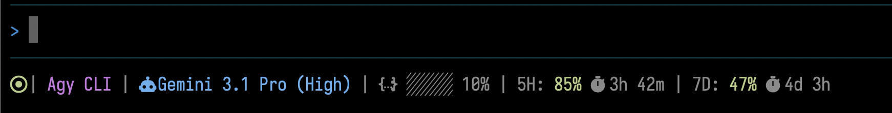

# Agy CLI Statusline

[](#-for-ai-agents)



## Overview

Welcome to my personal, minimalist configuration designed exclusively for the **Antigravity CLI**. 

When working with powerful **ai-agents**, keeping track of what's happening under the hood without cluttering your workspace is key. This **antigravity-cli extension** reads the raw JSON payload emitted by **Antigravity** and transforms it into a beautiful, highly legible **statusline** right in your **terminal**.

I built this with a focus on adaptability and aesthetics. It dynamically adjusts to your terminal width, ensuring that important telemetry data is always visible without wrapping awkwardly. The color palette relies on soft, modern pastel tones that are easy on the eyes during long coding sessions. It's the perfect companion for anyone looking to elevate their **CLI** experience.

## Compatibility & Requirements

This plugin is fully compatible with:
- **macOS**
- **Linux**
- **Windows (via WSL)**

Runtime dependencies:
- **`bash`** and **`jq`** (required)
- **`git`** (optional, used as a fallback when `vcs` metadata is omitted from the payload)

To get the most out of the visual experience, you should use a [Nerd Font](https://www.nerdfonts.com/). The glyphs and icons that make the status line pop rely heavily on Nerd Fonts (like JetBrains Mono or FiraCode). If you absolutely cannot use one, there is a classic fallback mode available.

## Installation

You can install the tool directly using the following remote installation one-liner:

```bash
curl -fsSL https://raw.githubusercontent.com/LeanoA/agy-cli-statusline/main/install.sh | sh
```
Or, if `curl` is unavailable:
```bash
wget -qO- https://raw.githubusercontent.com/LeanoA/agy-cli-statusline/main/install.sh | sh
```

Alternatively, if you have cloned the repository, you can install it locally:

```bash
./install.sh
```

This will deploy the script to `~/.local/share/agy-statusline` and automatically configure your Antigravity IDE (`~/.gemini/antigravity-cli/settings.json`) to use it.

## Uninstallation

To safely remove the plugin and restore your Antigravity configuration to its original state, run:

```bash
~/.local/share/agy-statusline/uninstall.sh
```

## Segments Breakdown

The status line dynamically renders the following data from the JSON payload:
*   **Status Indicator**: Shows the current agent state (Idle, Thinking, Working, Blocked).
*   **App Name**: Displays `Agy CLI`.
*   **Model**: The active LLM model. When running in `Orchestrator` mode, resolves the configured planner and executor roles from `AGY_SETTINGS_FILE` and displays `Orch: <Planner> → <Executor>` (using `->` in Classic Mode).
*   **Git**: Current branch and dirty state indicator.
*   **Context**: Progress bar and percentage for context window usage.
*   **Workers**: Active subagents and background tasks.
*   **Quotas**: Remaining 5H and 7D API quotas, plus reset times:
    *   **Dynamic Bucket Routing**: Automatically selects Argon (`gemini-argon-wtu-weekly`, falling back to unified `gemini-5h` / `gemini-weekly` when dedicated Argon buckets are absent), standard Gemini (`gemini-5h` / `gemini-weekly`), or third-party (`3p-5h` / `3p-weekly`) quota buckets based on the active model (or the active Orchestrator role, defaulting to the executor unless `plan` mode is reported). When a model only has a 7D bucket (such as legacy Argon WTU weekly), `5H: N/A` is rendered to preserve the two-column quota layout.
    *   **Mid-Turn Staleness & Burn-Rate Projection**: Because `agy` only refreshes `.quota` from the backend at the end of a prompt, long active turns (`thinking`/`working`) display a staleness age badge (`⟳Xm`, configurable via `AGY_QUOTA_STALE_SECONDS`, default `120`) and project remaining quota (`~X%`) from observed time/token burn rate, applying warning (`<=40%`) and critical (`<=15%`) colors to the projected value before quota runs out.

## Classic Mode

If you don't have a Nerd Font installed, you can enable a fallback mode using standard Unicode characters:
```bash
export AGY_CLASSIC_MODE=1
```

## Configuration (Environment Variables)

| Variable | Default | Description |
| :--- | :--- | :--- |
| `AGY_CLASSIC_MODE` | `0` | Set to `1` to replace Nerd Font icons with ASCII/Unicode fallbacks (`~4m` instead of `⟳4m`). |
| `AGY_SETTINGS_FILE` | `~/.gemini/antigravity-cli/settings.json` | Antigravity CLI settings file used to resolve Orchestrator planner/executor models. |
| `AGY_CACHE_DIR` | `~/.cache/agy-statusline` | Directory used for quota state caching and debug capture files. |
| `AGY_QUOTA_STALE_SECONDS` | `120` | Seconds before an unchanged quota snapshot during an active turn displays the staleness badge and burn-rate projection. |
| `AGY_QUOTA_STATE_FILE` | `$AGY_CACHE_DIR/quota-state.json` | JSON file storing per-session quota snapshots for staleness and burn-rate calculations. |
| `AGY_STATUSLINE_DEBUG` | `0` | Set to `1` to log raw payloads as JSONL. |
| `AGY_STATUSLINE_DEBUG_FILE` | `$AGY_CACHE_DIR/payloads.jsonl` | Destination file for captured payloads. |
| `AGY_STATUSLINE_DEBUG_FLAG` | `<debug_file_dir>/debug.on` | Sentinel file that enables payload capture live without restarting `agy`. |

## Debug: Payload Capture

To inspect the raw JSON payload that `agy` sends to the status line, enable capture via environment variable before launching `agy`, or toggle the sentinel file live during a running session:
```bash
export AGY_STATUSLINE_DEBUG=1
# Or toggle live without restarting agy:
mkdir -p ~/.cache/agy-statusline && touch ~/.cache/agy-statusline/debug.on
# Optional, defaults to ~/.cache/agy-statusline/payloads.jsonl
export AGY_STATUSLINE_DEBUG_FILE=/path/to/payloads.jsonl
```
Each invocation appends one JSONL line `{"ts": "...", "payload": {...}}`. Capture is off by default and never affects rendering.

## Testing

The repository uses [BATS](https://github.com/bats-core/bats-core) for automated verification (`tests/statusline.bats`, `tests/install.bats`, `tests/uninstall.bats`):

```bash
bats tests/
```

## Disclaimer

This is my personal configuration tailored to my daily workflow. I'm sharing it in the hopes that you find it as useful and pleasant to look at as I do.

## Future Work

- **Direct Mid-Turn Quota Telemetry**: While mid-turn staleness detection and time/token burn-rate projection (`~X% ⟳Xm`) mitigate delayed backend refreshes during long turns, `agy` currently updates `.quota[*].remaining_fraction` only at prompt completion. Future updates will adopt live mid-turn quota fields if `agy` exposes them natively.

---

## 🤖 For AI Agents

**Directory Context & Purpose**
This repository contains a bash-based rendering script (`statusline.sh`), its deployment wrappers (`install.sh`, `uninstall.sh`), and its BATS test suite (`tests/`). It acts as a plugin for the Antigravity ecosystem.

**Why it is useful:** 
It intercepts the standard JSON state payload generated by Antigravity and formats it into ANSI escape codes for terminal display, including dynamic quota routing (Argon, Gemini, 3p) and mid-turn staleness/burn-rate estimation.

**Key constraints for agents modifying this codebase:**
1. **Performance**: Keep the bash execution time minimal. The script runs on every state tick; heavy processing will lag the user's UI.
2. **Standardization**: Installation and uninstallation MUST strictly follow the XDG Base Directory Specification (e.g., `~/.local/share/agy-statusline`).
3. **Idempotency**: All setup/teardown scripts (`install.sh`, `uninstall.sh`) must be fully idempotent and safe to run multiple times. Do not mutate the user's shell profiles (`.bashrc`, `.zshrc`).
4. **Dependencies & Fault Tolerance**: Fallback gracefully. If `jq` is unavailable, fail fast; cache or debug I/O failures must never break status line rendering.
5. **Test-Driven Development**: Follow Strict TDD with `bats tests/` (verify RED before GREEN) for any change.
